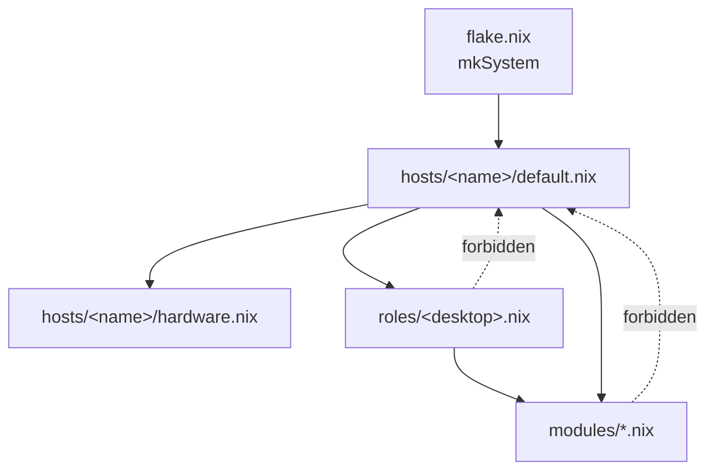

# Architecture

How the tree is layered, what each output is, and why the boundaries sit where
they do.

## Layout

```
nix/
├── flake.nix              # inputs, outputs, checks, mkSystem
├── hosts/                 # one directory per machine
│   ├── tower/             # default.nix + hardware.nix
│   ├── work-laptop/
│   ├── elitedesk-800-g4/  # dev server, role swapped by scripts/switch-desktop.sh
│   ├── dux-vm/            # VM-only preview of roles/dux.nix
│   ├── noctalia-vm/       # VM-only preview of roles/noctalia.nix
│   └── example/           # skeleton, copied when a machine joins
├── roles/                 # desktop compositions
├── modules/               # host-agnostic pieces, each guarded by an option
├── pkgs/                  # sources a module installs (agent-sandbox, luciole)
├── home/                  # Home Manager profiles
├── lib/forAllSystems.nix  # per-system output helper, replaces flake-utils
├── tests/hosts.nix        # one nixosTest per host
├── containers/dev/        # toolchain image, built with dockerTools
├── scripts/               # gates and helpers
└── .github/               # ci.yml and the image publish
```

## The layering

Three levels, one direction. A host imports a role, a role imports modules, and
nothing goes back up.



- **Host.** Identity and hardware. `networking.hostName`, the user account, the
  disk layout in `hardware.nix`, and the role import. Nothing reusable lives
  here.
- **Role.** Reusable composition. `roles/kde.nix` imports the modules a KDE
  machine needs and sets the defaults that belong to that desktop.
- **Module.** Host-agnostic. An option, a guard, and the config behind it.

The forbidden edges are enforced, not documented. `scripts/check-layering.py`
strips comments and string bodies, then fails on any code reference to `hosts/`
under `roles/` or `modules/`. `--self-test` proves the checker still catches a
violation, so a checker that stopped matching fails too.

`base-server` is a role-only output: `mkSystem ./roles/base.nix`. It exists so
the headless role keeps compiling without inventing a machine for it.

## flake.nix

`mkSystem` is the only constructor. It applies the shared
`nixpkgs.config.allowUnfree`, `specialArgs` for `inputs`, and the system string,
so every host is built the same way and a test harness can own options the host
does not need.

### Inputs

| Input | Pin | Why |
| --- | --- | --- |
| `nixpkgs` | `nixpkgs-unstable`, by `flake.lock` | one package set, no stable overlay |
| `home-manager` | `follows = "nixpkgs"` | same package set as the system |

`lib/forAllSystems.nix` replaces `flake-utils`: it nests each per-system output
under its system name. `devShells.default` is `pkgs.mkShell`, so `devshell` is
not an input either. Two inputs, one lock.

### Outputs

Per system (`x86_64-linux`):

| Output | What |
| --- | --- |
| `devShells.default` | toolchains, linters, `git`, `gh`, `direnv` |
| `packages.dev-image` | the OCI toolchain image, `dockerTools.buildLayeredImage` |
| `checks` | the gates below |

Top level:

| Output | What |
| --- | --- |
| `nixosConfigurations` | `base-server`, `tower`, `work-laptop`, `elitedesk-800-g4`, `dev-01` to `dev-04`, `dux-vm`, `noctalia-vm` |
| `homeConfigurations."hunter@x86_64-linux"` | the standalone HM profile |
| `templates.homeManager` | a starting point for another HM config |

### Checks

| Check | Proves |
| --- | --- |
| `layering` | no role or module names a path under `hosts/`, and `--self-test` shows the checker still fails a planted violation |
| `no-initial-password` | no `initialHashedPassword` outside `hosts/example/` |
| `agent-sandbox-proxy` | the proxy's allowlist, address filter and dialer |
| `work-laptop-boot` | the work-laptop loader choice and EFI install target match the ESP the host declares, which the QEMU host test cannot see |
| `dev-hostnames` | each EliteDesk unit wrapper overrides the shared hostname, so the four dev servers stay distinguishable |
| `<host>` (per host) | the real host module reaches `multi-user.target` in QEMU |

The host tests come from `tests/hosts.nix`. Each one builds from the real host
module with QEMU's root disk and without the NVIDIA GPU, waits for
`multi-user.target`, and asserts `sshd`, an active `firewall.service`, and one
service that host actually enables. `work-laptop` asserts `tlp.service`, not
`fwupd.service`: fwupd is `linked` there, never `enabled`, so `is-enabled` exits
non-zero on a correct system. `elitedesk-800-g4` goes past the unit: it checks
the Docker socket symlink exists, and that `podman info` and `docker info`
answer behind it, so a running socket with a dead runtime fails. The two VM previews assert their desktop wiring:
`dux-vm` the DMS user unit and SDDM, `noctalia-vm` the Noctalia unit's
`WantedBy=umbriel-session.target`, greetd, and the installed `luciole`. Those
tests prove wiring, not a live session: the test VM has no DRM device and no
GL, so the compositor starts only on real hardware or under the preview GPU.

## Module namespaces

One namespace per concern, so an option reads as where it comes from.

| Prefix | Module |
| --- | --- |
| `machines.agentSandbox` | `agent-sandbox.nix` |
| `machines.autoUpgrade` | `auto-upgrade.nix` |
| `machines.containers` | `containers.nix` |
| `machines.wallpapers` | `wallpapers.nix` |
| `machines.zram` | `zram.nix` |
| `commonPackages` | `common-packages.nix` |
| `gaming` | `gaming.nix` |
| `kde`, `xfce`, `hyprland`, `dux`, `noctalia` | the desktop modules |
| `multimedia`, `sysadmin`, `virtualization`, `pince`, `deployConfig` | same-named modules |

A module with no option applies its defaults on import: `base.nix`,
`networking.nix`, `security.nix`, `audio.nix`, `fonts.nix`, `laptop.nix`,
`development.nix`, `nvidia.nix`, `home-manager.nix`.

## Agents are contained

`agent-sandbox.nix` installs a launcher and an allowlisting `CONNECT` proxy. A
session is a transient `systemd-nspawn` container: read-only store, one
read-write project bind, tmpfs home, loopback only, and egress solely through the
proxy's unix socket. It is opt-in per host through `machines.agentSandbox`, so
nothing about agent isolation reaches a host that did not ask for it.

Two deliberate choices:

- `--private-users=<uid>:1`, so container root is the invoking host user. Files
  the session writes in the project are the owner's, and no host uid the session
  does not need is mapped.
- No `--volatile` or `--ephemeral`. Both need btrfs, and neither is what makes
  the session disposable; the tmpfs home and the absence of a host home mount
  are.

[AGENT-SANDBOX.md](AGENT-SANDBOX.md) states the boundary and what it does not
cover.

## Update path

`machines.autoUpgrade` is the only update path, and it is two pieces:

- `system.autoUpgrade` rebuilds `flakePath#<host>` with `--no-update-lock-file`,
  so a switch never moves an input, and with `allowReboot = false`, so a kernel
  or driver change waits for the next boot.
- The `nixos-upgrade` service's `preStart` runs `git fetch origin <ref>` then
  `git merge --ff-only FETCH_HEAD` in `flakePath`.

The fast-forward is what makes the reviewed-commit rule true: a host only moves
to a commit that is already on `origin/main`, and `main` only moves through CI.
The flake attribute in the unit names the host, so the rebuild cannot pick up a
different one.

`safe.directory` names `flakePath` rather than `*`, so the git trust the unit
grants is the one checkout it reads.

## Home Manager, two ways

| Wiring | Where |
| --- | --- |
| NixOS module | `modules/home-manager.nix`, imported by every role |
| Standalone | `homeConfigurations."hunter@x86_64-linux"`, for a non-NixOS host |

Standalone is what a macOS or foreign-Linux machine uses:
`home-manager switch --flake .#hunter@x86_64-linux`.

## Maintenance defaults

`nix.gc` runs on a timer: three system generations, store paths older than 14
days. The rollback window is short on purpose, and it is the same on every host
because it lives in `modules/base.nix`.

ZRAM comes from `modules/zram.nix`, imported by `base.nix`. Auto-sizing is
`min(total_ram / 2, machines.zram.maxSize)`, with `lz4` by default.

## Security defaults

`modules/security.nix` enables the firewall and sshd, with password
authentication and root login off. No password hash is committed for a real
host, so an account starts locked and the first password is set on the console.

## Development shell

```bash
nix develop
```

Nix formatters and linters, `git`, `gh`, `direnv`, the language toolchains,
`docker`, `cmake`, `pkg-config` and `just`. The same toolchain, packaged, is
`dev-image` and published to `ghcr.io/ultus-net/nix-dev` from `main` only.

## CI

`.github/workflows/ci.yml` proves behaviour. The branch-name job checks the
prefix, `flake check` runs the gates above, and the build job builds each host's
toplevel. `nix flake check` boots a VM per host, so a run takes 15 to 25 minutes.

`.github/CI-CD-GUIDE.md` lists what each job proves.
