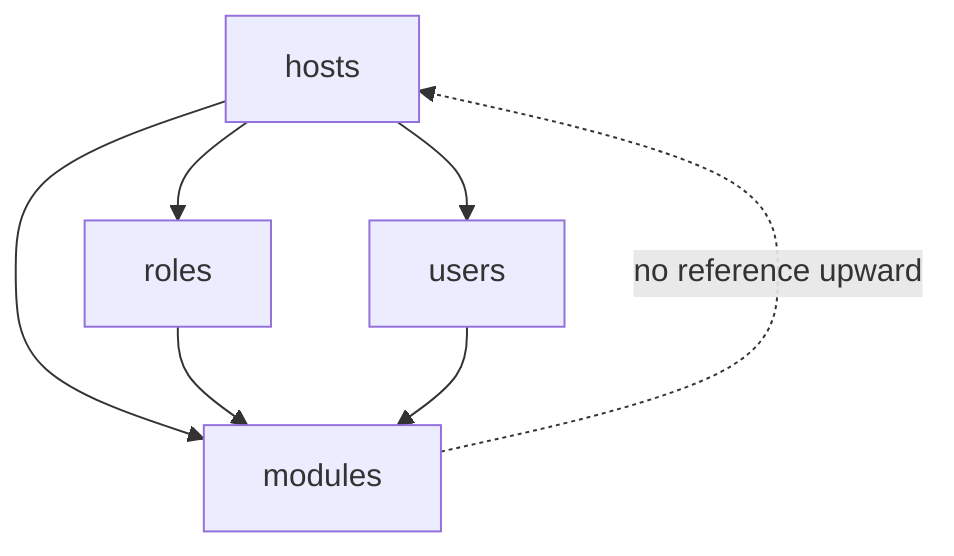

# nixos-base overhaul: design

Status: draft for adversarial review
Date: 2026-11-18

## Intent

`nixos-base` currently works for its owner but is a poor example of a flake. The
dependency direction between profiles and machines is inverted, six desktop
profiles repeat the same boilerplate, security-relevant defaults are wrong for
some hosts, CI validates syntax instead of behaviour, and inputs are a year
stale.

The overhaul turns it into a personal, publicly readable multi-host flake with
honest layering, a small desktop set, a real verification gate, and one new
capability: a sandbox for coding agents.

The owner's hardware configuration is already generated and committed. No
reinstall and no disk encryption work is in scope.

## Goals

1. Hosts, roles and modules layer in one direction only: host -> role -> module.
   A role never references a host.
2. Three desktop environments survive: KDE, Hyprland, XFCE. The other three are
   deleted.
3. Gaming tuning and the agent sandbox stop sharing one set of global defaults.
   A host opts into each.
4. `nix flake check` is the gate. CI builds both hosts, enforces formatting and
   dead-code lint, and blocks on failure.
5. Agents execute inside an nspawn container that cannot see the owner's keys,
   home directory or credentials, with an egress allowlist and an ephemeral root.
6. Documentation describes the tree that exists, not the two trees that used to
   exist.

## Non-goals

- Disk encryption, secure boot, TPM, remote attestation. Explicitly out.
- Moving to NixOS as a whole-disk role change. This is a config refactor.
- Bumping `system.stateVersion`. It stays `24.11` and only moves when the owner
  reinstalls.
- Secrets management (sops/agenix). There are no secrets in the repo today and
  the sandbox design is what keeps it that way.
- Remote access (Tailscale, VPN, bastion). Out of scope, noted as a follow-up.
- A microVM tier. Container isolation is the chosen level; microVM stays a
  documented escalation path, not an implementation.

## Constraints

- `nix` is not installed on the machine this design was written on. Every claim
  about evaluation must be proven by CI or by the owner running
  `nixos-rebuild build`.
- `main` is unprotected and direct pushes are possible. The workflow rules
  require branch protection, so enabling it is part of the work.
- `machines/hardware-configuration.nix` is host-specific truth. It moves, it is
  not rewritten.
- The repo is public. Host details already published (disk UUID, monitor
  serials) are accepted debt; new personal data does not get added.

## Approaches considered

### A. Layering only

Reorganise the tree and stop. Sandboxing stays manual: the owner runs agents in
an ad-hoc `nix shell` with whatever hardening is remembered that day.

Cheapest, and it fixes the structural problems. It fails the actual requirement,
because a sandbox that depends on the operator remembering flags is not a
sandbox.

### B. Layering plus declarative nspawn sandbox (chosen)

Reorganise the tree, then add `containers.agent` as a declarative NixOS
container with a project bind mount, no home mount, private network, and
ephemeral root. Isolation is namespace-level. Kernel is shared.

This is the design below. It is testable in CI, boots in under a second, and
keeps the whole boundary in one module.

### C. Layering plus microVM per session

`microvm.nix`, KVM boundary, ephemeral disk. Strongest isolation and the honest
answer if the threat includes hostile binaries. Cost is more moving parts,
slower starts, and KVM dependence on the work laptop.

Rejected as the default because it is friction, and friction gets routed around.
Kept as a documented escalation: the sandbox contract (project mount, no home,
egress allowlist) is written so a microVM can replace the container without
changing how sessions are launched.

## Target tree



```
flake.nix                 inputs, outputs, formatter, checks
hosts/
  tower/
    default.nix           identity, imports, host options
    hardware.nix          generated partition/mount truth
  work-laptop/
    default.nix
    hardware.nix
roles/
  desktop-kde.nix
  desktop-hyprland.nix
  desktop-xfce.nix
  gaming.nix
  secure-dev.nix
  server.nix
modules/
  *.nix                   feature modules with typed options
users/
  hunter.nix              home-manager config
lib/
  mkSystem.nix            nixosSystem wrapper
scripts/
  check-layering.sh       fails if roles/ or modules/ mention hosts/
  agent-sandbox.sh        start/stop/shell for the container
documentation/
```

Rules the tree encodes:

- `hosts/*` is the only place a hostname, timezone, hardware path, or user
  appears.
- `roles/*` compose modules and set defaults with `lib.mkDefault`. No host paths.
- `modules/*` own options and implementation. Importing a module has no effect
  until the host or role enables it.
- `--hostname`-style placeholders, example machines, and generated-docs drift go
  away.

## Decisions

### D1. Rename `machines/` to `hosts/`, `profiles/` to `roles/`

One-time `git mv` in the first commit so history follows the files. The words
match what the things are: a host is a physical machine, a role is a job the
machine does.

### D2. Hardware files live with the host, never with a role

`fileSystems` placeholders disappear from roles entirely. A role that could
boot against `/dev/disk/by-label/nixos-root` is a footgun: it evaluates and
installs a system that cannot mount its own root. Hosts carry real hardware
config, or they are examples that do not enter `nixosConfigurations`.

### D3. Desktop set is KDE, Hyprland, XFCE

Deleted: `profiles/cosmic.nix`, `profiles/gnome.nix`, `profiles/cinnamon.nix`,
`modules/cosmic.nix`, `modules/gnome.nix`, `modules/cinnamon.nix`, plus the
COSMIC install guide and the 160 commented-out COSMIC lines in
`home/hunter.nix`. `tower` runs KDE. `work-laptop` runs XFCE (light, and it is a
work machine). Hyprland stays buildable and selectable.

### D4. One NixOS container, declared in a module

`modules/agent-sandbox.nix` declares `containers.agent` with:

- `config`: minimal NixOS, `environment.systemPackages` carrying git, nix,
  bash, ripgrep, and the agent CLIs.
- `bindMounts.project`: read-write mount of one project directory, chosen at
  start time by the wrapper. Nothing else from `/home`.
- `bindMounts.agent-auth`: read-only mount of a single token file, when the
  agent needs one. Explicit and per-agent.
- `privateNetwork = true` with a container-local firewall allowlisting `github.com`,
  `cache.nixos.org`, `registry.npmjs.org` and the agent vendor API, so package
  installs work and arbitrary egress does not.
- `ephemeral = true`: root filesystem discarded on stop.
- No `hunter` user inside. One `agent` user, no sudo, no password.

Launch path is `scripts/agent-sandbox.sh <project-dir>`, which starts the
container, bind-mounts the project, opens a shell as `agent`, and stops the
container on exit. The script is the only supported entry point.

### D5. Gaming tuning becomes opt-in, and `mitigations=off` goes

`roles/gaming.nix` keeps the parts that are real wins and carry no security
cost: zram, BBR, `nowatchdog`, THP, I/O scheduler, gamemode, scheduler. It drops
`mitigations=off` (a 5 to 10 percent CPU gain is a poor trade on a box that runs
agents) and `tsc=reliable`/`clocksource=tsc` unless the owner asks for them back.

`kernel.yama.ptrace_scope = 0` moves out of the global base config. Default is
`1`. PINCE gets an opt-in that sets `0` on the hosts that want it. PINCE is also
removed from `roles/server.nix`.

This is the one decision the owner should veto if he disagrees. It is one line
in one file to reverse.

### D6. One update path

`modules/auto-update.nix` is deleted. `system.autoUpgrade` is the only updater,
configured per host, with the flake path an option rather than a hardcoded
`/home/hunter/Documents/nixos-base`. `nix.gc` stays where it is, next to it.

### D7. Inputs: one nixpkgs, no stable overlay, no flake-utils

- `nixpkgs-unstable` only. `nixpkgs-stable` and the `google-chrome` overlay are
  deleted. Chrome comes from unstable like everything else.
- `flake-utils` is dropped. With one architecture, an explicit
  `forAllSystems` helper in `lib/` is three lines and one fewer input.
- `home-manager` follows nixpkgs, unchanged.
- `devshell` is dropped. A `devShells.default = pkgs.mkShell` replaces it; the
  devshell overlay and the `setup-dev` command go with it.

### D8. Flake outputs become honest

- `nixosConfigurations`: one entry per host. The six
  `<desktop>-workstation` outputs disappear.
- `formatter.x86_64-linux = nixfmt-rfc-style`.
- `checks.x86_64-linux`: formatting check, `statix`, `deadnix`, and the layering
  check. These are the things `nix flake check` runs.
- `packages.cosmicImage` and `packages.kdeImage` are deleted. They are unused
  OCI demos, not part of any host.
- `packages.default` (the `cosmic-qol` echo script) is deleted.
- `homeConfigurations` keeps `hunter@x86_64-linux`; the dead commented examples
  go.
- `templates.homeManager` retargets at the surviving home config.

### D9. CI replaces validation theatre with builds

`.github/workflows/ci.yml`:

| Job | What it proves |
| --- | --- |
| `flake-check` | `nix flake check` passes; formatting, statix, deadnix, layering |
| `build` (matrix: tower, work-laptop) | `nix build .#nixosConfigurations.<host>.config.system.build.toplevel` |
| `branch-name` | branch matches the allowed prefixes |
| `vm-boot` (label `test-vm-boot`) | host reaches multi-user.target in QEMU |

Deleted from CI: per-file `nix-instantiate --parse`, the `grep` secret scan that
cannot see `initialHashedPassword`, the `flake.json` introspection dance, the
`accept-flake-config = true` setting, and the six-way desktop matrix.

Cache: `nix-community/cache-nix-action` (Magic Nix Cache), no token.

### D10. Bootstrap credentials become an explicit, loud step

`initialHashedPassword = ""` stays only in `hosts/example/`, which is not
exported. Real hosts get a documented `users.users.hunter.hashedPasswordFile`
or a first-boot `passwd`. The CI check that guards this is a `grep` for
`initialHashedPassword` outside `hosts/example/`, which is case-sensitive and
therefore actually catches the attribute.

### D11. State that must not break

`system.stateVersion = "24.11"`, `home.stateVersion = "24.11"`, the games-drive
mount, the SDDM kscreen symlink, the Flatpak overrides and the NVIDIA setup all
carry over unchanged in behaviour. Each one is moved with its options intact,
not rewritten.

## Migration order

Each commit evaluates on its own, so a bisect stays useful.

1. `refactor: move machines to hosts and profiles to roles` (git mv only, plus
   import path fixes and the layering check).
2. `refactor: delete unused desktops and dead modules` (COSMIC, GNOME, Cinnamon,
   `modules/boot.nix`, `example-machine.nix`, OCI images).
3. `refactor: type the module surface` (delete `common-users.nix`, typed
   options everywhere, PINCE opt-in).
4. `refactor: split gaming tuning from secure-dev` (`mitigations`, ptrace, DE
   roles per host).
5. `refactor: single update path` (delete `auto-update.nix`).
6. `chore: refresh inputs` (drop stable, flake-utils, devshell; lock update).
7. `ci: replace validation with builds` (new workflow, formatter, checks).
8. `feat(agent-sandbox): declarative nspawn sandbox` (module, script, docs).
9. `docs: rewrite documentation for the new tree` (README, ARCHITECTURE,
   INSTALL, delete the two overlapping install guides, one survives).

## Acceptance checks

- `nix flake check` exits 0.
- `nix build .#nixosConfigurations.tower.config.system.build.toplevel` succeeds
  in CI for both hosts.
- `nixos-rebuild build --flake .#tower` succeeds on the real machine.
- `scripts/agent-sandbox.sh ~/Projects/x` gives a shell where:
  `ls ~/.ssh` fails, `cat ~/.gnupg/pubring.kbx` fails, `curl https://example.com`
  fails, `git clone https://github.com/NixOS/nixpkgs` works, and stopping the
  container discards writes outside the project mount.
- `./scripts/switch-desktop.sh hyprland` still rebuilds a working session.
- `git grep -n 'initialHashedPassword = ""' -- ':!hosts/example'` is empty.
- `main` requires the CI check and a PR, and head branches auto-delete.

## Risks

| Risk | Mitigation |
| --- | --- |
| nspawn shares the host kernel; a kernel bug escapes the cage | Accepted, documented. MicroVM is the escalation path and the launch contract does not change |
| Ephemeral root discards agent state each session (auth, caches) | Auth is an explicit read-only mount; caches are cheap to rebuild; the project mount persists |
| Egress allowlist breaks a package fetch | Allowlist covers github, cache.nixos.org, npm; adding a host is a one-line change with a comment naming the reason |
| Nix inside the container needs store access and experimental features | Container config sets `nix.settings.experimental-features`; store is shared by the NixOS container mechanism, verified in acceptance |
| Two full system builds on GitHub runners are slow | Magic Nix Cache, and only two hosts. If it exceeds the free minutes, move to a self-hosted runner or build only on PRs that touch `hosts/` |
| Dropping `mitigations=off` costs gaming performance | Owner may veto D5; it is one line |

## Open questions for the owner

1. Does `work-laptop` stay in this repo, or does the repo drop to `tower` only
   and the laptop get its own flake? Keeping both is fine but doubles CI.
2. Veto D5 (`mitigations=off` removal) or keep it?
3. Initial egress allowlist: is the agent only talking to GitHub and its vendor
   API, or does it need package registries beyond npm?
