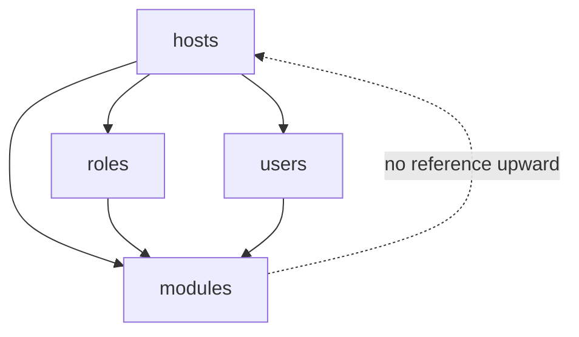

# nixos-base overhaul: design

Status: draft, after adversarial review round 1
Date: 2026-11-18

## Intent

`nixos-base` currently works for its owner but is a poor example of a flake. The
dependency direction between profiles and machines is inverted, six desktop
profiles repeat the same boilerplate, security-relevant defaults are wrong for
some hosts, CI validates syntax instead of behaviour, and inputs are a year
stale.

The overhaul turns it into a personal, publicly readable multi-host flake with
honest layering, a small desktop set, a real verification gate, and one new
capability: a sandbox for coding agents.

The owner's hardware configuration is already generated and committed. No
reinstall and no disk encryption work is in scope.

## Goals

1. Hosts, roles and modules layer in one direction only: host -> role -> module.
   A role never references a host.
2. Three desktop environments survive: KDE, Hyprland, XFCE. The other three are
   deleted.
3. Gaming tuning and the agent sandbox stop sharing one set of global defaults.
   A host opts into each.
4. `nix flake check` is the gate. CI builds both hosts, enforces formatting and
   dead-code lint, and blocks on failure.
5. Agents execute inside a per-session nspawn container that cannot see the
   owner's keys, home directory or credentials, cannot reach the host Nix daemon,
   and reaches the network only through a host-side allowlisting proxy.
6. Documentation describes the tree that exists, not the two trees that used to
   exist.

## Non-goals

- Disk encryption, secure boot, TPM, remote attestation. Explicitly out.
- Moving to NixOS as a whole-disk role change. This is a config refactor.
- Bumping `system.stateVersion`. It stays `24.11` and only moves when the owner
  reinstalls.
- Secrets management (sops/agenix). There are no secrets in the repo today and
  the sandbox design is what keeps it that way.
- Remote access (Tailscale, VPN, bastion). Out of scope, noted as a follow-up.
- A microVM tier inside the flake. A libvirt VM on the tower is the escalation
  path, provisioned separately (see `documentation/design/2026-11-18-opentofu-devserver.md`).

## Constraints

- `nix` is not installed on the machine this design was written on. Every claim
  about evaluation must be proven by CI or by the owner running
  `nixos-rebuild build`.
- `main` is unprotected and direct pushes are possible. The workflow rules
  require branch protection, so enabling it is part of the work.
- `machines/hardware-configuration.nix` is host-specific truth for tower only.
  `machines/work-laptop.nix:47-68` carries its hardware inline and has no
  hardware file. Splitting it is real work, not a rename.
- The repo is public. Host details already published (disk UUID, monitor
  serials) are accepted debt; new personal data does not get added.

## Approaches considered

### A. Layering only

Reorganise the tree and stop. Sandboxing stays manual: the owner runs agents in
an ad-hoc `nix shell` with whatever hardening is remembered that day.

Cheapest, and it fixes the structural problems. It fails the actual requirement,
because a sandbox that depends on the operator remembering flags is not a
sandbox.

### B. Layering plus per-session nspawn container (chosen)

Reorganise the tree, then add a launcher that starts a transient nspawn
container per session: private user namespace, project-only bind mount, no home,
no host Nix daemon, egress only through a host proxy. Ephemeral root.

Isolation is namespace-level and the kernel is shared. That is accepted, and the
libvirt VM is the documented escalation.

### C. Layering plus microVM per session

`microvm.nix`, KVM boundary, ephemeral disk. Strongest isolation and the honest
answer if the threat includes hostile binaries. Cost is more moving parts,
slower starts, and KVM dependence on the work laptop.

Rejected as the default because it is friction, and friction gets routed around.

## Target tree



```
flake.nix                 inputs, outputs, formatter, checks
hosts/
  tower/
    default.nix           identity, imports, host options
    hardware.nix          generated partition/mount truth
  work-laptop/
    default.nix
    hardware.nix          extracted from the current inline block
roles/
  desktop-kde.nix
  desktop-hyprland.nix
  desktop-xfce.nix
  gaming.nix
  secure-dev.nix
  server.nix
modules/
  *.nix                   feature modules with typed options
users/
  hunter.nix              home-manager config
lib/
  mkSystem.nix            nixosSystem wrapper
scripts/
  check-layering.sh       parses imports, fails on upward references
  agent-sandbox.sh        installed by the module, not read from the project
documentation/
```

Rules the tree encodes:

- `hosts/*` owns hostname, timezone, hardware paths, the primary user, and
  `home-manager.users.<name>` wiring. One typed interface: `hosts.<name>`.
- `roles/*` compose modules and set defaults with `lib.mkDefault`. No host paths,
  no usernames.
- `modules/*` own options and implementation. Importing a module has no effect
  until a host or role enables it.

## Decisions

### D1. Rename `machines/` to `hosts/`, `profiles/` to `roles/`

One-time `git mv` in its own commit so history follows the files. The laptop
hardware extraction is a separate, reviewable commit after the rename, because
`machines/work-laptop.nix:47-68` is inline and the owner must confirm the UUIDs.

### D2. Hardware files live with the host, never with a role

`fileSystems` placeholders disappear from roles entirely. A role that could boot
against `/dev/disk/by-label/nixos-root` is a footgun: it evaluates and installs a
system that cannot mount its own root. The tower `fileSystems."/games"` mount
gains `nofail`, because a QEMU boot has no games disk and systemd otherwise
blocks at `local-fs.target` (`machines/tower.nix:38-50`).

### D3. Desktop set is KDE, Hyprland, XFCE

Deleted: `profiles/cosmic.nix`, `profiles/gnome.nix`, `profiles/cinnamon.nix`,
`modules/cosmic.nix`, `modules/gnome.nix`, `modules/cinnamon.nix`, the COSMIC
install guide, and the 160 commented-out COSMIC lines in `home/hunter.nix`.
`tower` keeps KDE. `work-laptop` moves from COSMIC to KDE, per the owner
decision: one desktop role then covers both hosts, at the cost of a heavier
session on laptop hardware.

`scripts/switch-desktop.sh` is rewritten against host-scoped roles. Today it
lists no Hyprland (`scripts/switch-desktop.sh:11-17`) and builds removed
`<desktop>-workstation` outputs (`:77`), so the old script cannot survive.

### D4. Sandbox: per-session transient nspawn, not a singleton container

A declarative `containers.agent` cannot meet the requirement. `bindMounts` are
resolved at evaluation time, so the project and token paths cannot be chosen per
session. It also maps container root to host root unless `privateUsers` is set,
and the NixOS container binds the host `/nix/var/nix/daemon-socket` read-only,
which the agent can still connect to. A daemon connection lets the agent build
fixed-output derivations whose builders run on the host with host networking:
that is a complete egress bypass and arbitrary host compute.

Revised shape:

- **Launcher:** `agent-sandbox` is installed by `modules/agent-sandbox.nix` into
  the system profile. It is root-owned, outside any project directory, and never
  executes code from the mounted project.
- **Namespace:** `systemd-nspawn --private-users=pick
  --private-users-ownership=map`, all capabilities dropped, no devices beyond
  `/dev/{null,zero,full,random,urandom,tty}`.
- **Filesystem:** `--ephemeral`, one read-write bind of the chosen project
  directory, one tmpfs for the agent home. No host home, no `/etc`, no
  `/var/run/dbus`, no container access to the host journal or systemd.
- **Nix:** `/nix/store` is bind-mounted read-only and the daemon socket is
  *not* mounted. The sandbox therefore has a fixed pre-realised tool closure and
  cannot build. Projects that need more tooling get the closure realised on the
  host before launch; this is stated in the module docs rather than hidden.
- **Network:** `--network-veth` with a per-session address. Container egress is
  a single nftables rule: allow the host proxy address, drop everything else,
  including direct DNS. The host runs an allowlisting TLS CONNECT proxy
  (hostname allowlist, no IP passthrough). Clients use it as
  `http_proxy`/`https_proxy` and have no other resolver, so DNS tunnelling is
  not available. The owner's allowlist: GitHub, the agent vendor API,
  `cache.nixos.org`, the npm registry, PyPI, and the Go module proxy. A new entry
  needs a reason recorded beside it, per the risks table.
- **Token:** no long-lived credential exists. Each session completes a device
  flow against the agent vendor, and the short-lived token is brokered into the
  agent-home tmpfs, readable and writable only by the mapped uid, destroyed at
  stop. Nothing durable exists to leak from the sandbox.
- **Limits:** `TasksMax`, `MemoryMax`, `CPUQuota` on the nspawn scope, so a fork
  bomb or memory hog inside does not take the desktop down.
- **Lifecycle:** a transient unit owned by the host, not a shell trap. A crashed
  launcher still leaves a unit that is reaped, and `agent-sandbox stop --all`
  sweeps.

What still escapes: a kernel bug, or a container escape via a privileged device
that was not dropped. Both are accepted and both are closed by moving the same
workload into the libvirt VM.

### D5. Gaming tuning becomes opt-in, and `mitigations=off` goes

`roles/gaming.nix` keeps the parts that are real wins and carry no security
cost: zram, BBR, `nowatchdog`, THP, I/O scheduler, gamemode, scheduler. It drops
`mitigations=off` (5-10 percent CPU is a poor trade on a box that runs agents)
and `tsc=reliable`/`clocksource=tsc` unless the owner asks for them back.

`kernel.yama.ptrace_scope = 0` moves out of the global base config. Default is
`1`. PINCE gets an opt-in that sets `0` on the hosts that want it, and PINCE is
removed from `roles/server.nix`.

### D6. One update path

`modules/auto-update.nix` is deleted. `system.autoUpgrade` is the only updater,
configured per host, with the flake path an option rather than a hardcoded
`/home/hunter/Documents/nixos-base`. `nix.gc` stays beside it.

Open point: none. The owner tracks the remote branch and updates only commits
that passed CI, so nothing reaches a host without a merged PR. A local
experiment needs an explicit `nixos-rebuild switch`.

### D7. Inputs: one nixpkgs, no stable overlay, no flake-utils

- `nixpkgs-unstable` only. `nixpkgs-stable` and the `google-chrome` overlay are
  deleted. Chrome comes from unstable.
- `flake-utils` is dropped. With one architecture, an explicit `forAllSystems`
  helper in `lib/` is three lines and one fewer input.
- `home-manager` follows nixpkgs, unchanged.
- `devshell` is dropped. `devShells.default = pkgs.mkShell` replaces it.

### D8. Flake outputs become honest

- `nixosConfigurations`: one entry per host. The six `<desktop>-workstation`
  outputs disappear; desktop choice becomes a role import inside the host.
  `base-server` keeps its current role-only output until phase 2 gives it a host
  entry point, and stays in the CI build matrix in the meantime.
- `formatter.x86_64-linux = nixfmt-rfc-style`.
- `checks.x86_64-linux`: formatting check, `statix`, `deadnix`, layering check,
  and one `nixosTest` per host.
- `packages.cosmicImage`, `packages.kdeImage`, and `packages.default` (the
  `cosmic-qol` echo script) are deleted. Nothing consumes them.
- `homeConfigurations` keeps `hunter@x86_64-linux`.
- `templates.homeManager` retargets at the surviving home config.
- `homeManagerModules.default` (the 120-line COSMIC QoL module inside
  `flake.nix:207-326`) is deleted, not moved. It duplicates `users/hunter.nix`.

### D9. CI replaces validation theatre with builds

`.github/workflows/ci.yml`:

| Job | What it proves |
| --- | --- |
| `flake-check` | `nix flake check` passes: formatting, statix, deadnix, layering, `nixosTest` |
| `build` (matrix: tower, work-laptop, base-server) | `nix build .#nixosConfigurations.<host>.config.system.build.toplevel` |
| `branch-name` | branch matches the allowed prefixes, using `github.head_ref` and exempting `main` |

Deleted from CI: per-file `nix-instantiate --parse`, the `grep` secret scan that
cannot see `initialHashedPassword`, the `flake.json` introspection dance,
`accept-flake-config = true`, the six-way desktop matrix, and the QEMU serial
scraper.

Testing replaces the scraper with `nixosTest` per host. A host test asserts
`multi-user.target` plus host-specific facts (firewall on, expected services
active), and runs under `checks` so `nix flake check` executes it. The tower
test overrides `/games` and the NVIDIA device so it does not depend on hardware
that QEMU does not have.

Cache: `nix-community/cache-nix-action` is the GitHub Actions cache, keyed on
`flake.lock`, not a binary cache. It is worth testing, not assuming: the two
closures may exceed the 10 GB allowance and the restore can cost more than it
saves. Public-repo standard runners are free, so wall time is the real cost, not
minutes.

### D10. Bootstrap credentials become an explicit, loud step

`initialHashedPassword = ""` stays only in `hosts/example/`, which is not
exported. Real hosts use `users.users.hunter.hashedPasswordFile`, provisioned
root-only before the first switch, or a first-boot `passwd`. Activation reads the
file on every switch, so the file must exist and stay readable by root; the
migration commit removes the old `initialHashedPassword` attributes in the same
change that adds the file. A CI check greps for `initialHashedPassword` outside
`hosts/example/`; it is case-sensitive, so it actually matches.

### D11. State that must not break

`system.stateVersion = "24.11"`, `home.stateVersion = "24.11"`, the games-drive
mount, the SDDM kscreen symlink, the Flatpak overrides and the NVIDIA setup all
carry over in behaviour. Each moves with its options intact, not rewritten.

### D12. Dev image: toolchains in OCI, not a second boundary

A `dev-image` flake output carries the toolchains these projects use (Node and
TypeScript, Python, Go) plus the three agent CLIs, so a session starts with its
dependencies present instead of fetching them.

- Built by `dockerTools.buildLayeredImage` from the flake's pinned nixpkgs.
  No Dockerfile, so packages cannot drift from the host set.
- It claims no confinement. Network is open and the container is an ordinary
  container. Confinement remains D4.
- Project mounted at `/workspace`, no host home, uid 1000. Rootless podman maps
  that uid to the operator, so files written to the project stay theirs.
- Published to `ghcr.io/ultus-net/nixos-base-dev` from `main` only. Pull
  requests build the image and skip the push.
- Rust, C/C++, and a Nix daemon are absent by choice. A project that needs them
  adds one line to `containers/dev/default.nix`.

## Migration order

Every commit keeps CI green, so a bisect stays useful.

1. `ci: make the pipeline tolerant of the move` — drop the `machines/` and
   desktop-output assertions, add the layering check, keep everything else.
2. `refactor: move machines to hosts and profiles to roles` — `git mv` plus
   import path fixes.
3. `refactor: extract laptop hardware` — split
   `machines/work-laptop.nix:47-68` into `hosts/work-laptop/hardware.nix`.
4. `refactor: delete unused desktops and dead modules` — COSMIC, GNOME, Cinnamon,
   `modules/boot.nix`, `example-machine.nix`, OCI images, `homeManagerModules`.
5. `refactor: type the module surface` — delete `common-users.nix`, typed
   options, PINCE opt-in.
6. `refactor: split gaming tuning from secure-dev` — mitigations, ptrace, DE role
   per host.
7. `refactor: single update path` — delete `auto-update.nix`.
8. `chore: refresh inputs` — drop stable, flake-utils, devshell; lock update.
9. `ci: replace validation with builds` — new workflow, `nixosTest`, formatter,
   checks.
10. `feat(agent-sandbox): per-session nspawn sandbox` — module, launcher, proxy,
    docs.
11. `docs: rewrite documentation for the new tree`.
12. `feat(containers): dev image built from the flake` — `containers/dev`, the
    `dev-image` output, and the ghcr workflow. Independent of 1 to 11; it
    touches no host and can land in any order.

## Acceptance checks

- `nix flake check` exits 0, including both `nixosTest`s.
- `nix build .#nixosConfigurations.tower.config.system.build.toplevel` succeeds
  in CI for both hosts.
- `nixos-rebuild build --flake .#tower` succeeds on the real machine.
- Sandbox, with positive controls proving the test can fail:
  - `curl https://example.com` fails; `curl https://github.com` succeeds.
  - `curl https://1.1.1.1` fails, and `dig @1.1.1.1 example.com` fails.
  - `ls /home/hunter` fails.
  - `cat /nix/var/nix/daemon-socket/socket` fails and `nix build` fails.
  - A file written outside the project mount is gone after `stop`.
  - `ps` inside shows no host processes.
  - Starting twice concurrently gives two isolated units.
- `agent-sandbox` resolves from `/run/current-system/sw/bin`, not from the
  project.
- `nix build .#dev-image` succeeds, and the image runs `node --version`,
  `uv --version`, `go version`, and one agent CLI without extra setup.
- `./scripts/switch-desktop.sh hyprland` rebuilds a working session on tower.
- `git grep -n 'initialHashedPassword' -- ':!hosts/example'` is empty.
- `main` requires the CI check and a PR, and head branches auto-delete.

## Risks

| Risk | Mitigation |
| --- | --- |
| Shared kernel; a kernel bug escapes | Accepted. The libvirt VM is the escalation and the launcher contract does not change |
| Ephemeral root discards agent state (auth, caches) | Auth is a per-session tmpfs token; caches rebuild inside the session |
| Fixed tool closure is too narrow for some projects | Host realises the closure before launch; documented, and `agent-sandbox --with <flake-attr>` extends it explicitly |
| Proxy allowlist breaks a fetch | Allowlist is a single list with a reason per entry |
| `private-users-ownership=map` needs a filesystem that supports idmapped mounts | ext4 on tower does; verified by the acceptance check that writes into the project |
| Two full builds are slow | Measure first. Public runners are free; if wall time hurts, build only hosts touched by the diff |
| Dropping `mitigations=off` costs gaming performance | Owner may veto D5; it is one line |

## Owner decisions, answered 2026-11-18

| # | Question | Answer | Consequence |
| --- | --- | --- | --- |
| 1 | Does `work-laptop` stay, and which desktop? | Stays, moves to KDE | D3: one desktop role covers both hosts, heavier on laptop hardware |
| 2 | Veto D5 (dropping `mitigations=off`)? | No veto | Kernel mitigations on for every host |
| 3 | Egress allowlist beyond GitHub, the agent API and `cache.nixos.org` | npm registry, PyPI, Go module proxy | D4: six entries total |
| 4 | Auto-upgrade source | Reviewed remote commits only | D6: follows `origin/main`, so a PR gates every change |
| 5 | Keep a server role? | Keep `base-server` as is | Stays in the CI build matrix, so it cannot rot unnoticed |
| 6 | Long-lived agent credential? | None; per-session device flow | D4 token bullet: nothing durable to leak |
| 7 | Rename `hunter` to `cycl`? | No, `hunter` stays | No rename in this overhaul |

## Appendix: adversarial review round 1

Reviewer: Kimi K3.1 Pro, adversarial pass over this document and the repo.
Verdict: REVISE_SHAPE. Resolutions:

| Finding | Resolution |
| --- | --- |
| Container root maps to host root (`privateUsers` default) | D4: `--private-users=pick` with idmapped ownership, all caps dropped |
| Host Nix daemon socket reachable inside container | D4: daemon socket not mounted; fixed closure; `nix build` fails by design |
| Declarative `bindMounts` cannot be chosen per session | D4: transient per-session nspawn from an immutable launcher |
| `privateNetwork = true` provides no connectivity as described | D4: veth with explicit addressing and a host proxy |
| FQDN allowlist is not expressible in nftables; DNS tunnelling | D4: allowlisting CONNECT proxy, no other resolver, drop direct egress |
| Launcher inside the project can be rewritten by the agent | D4: launcher installed into the system profile |
| Token readable when mounted read-only | D4: per-session tmpfs copy, destroyed at stop |
| Migration commits are red | Migration order: CI-tolerance commit first |
| `switch-desktop.sh` cannot build removed outputs | D3: rewritten against host-scoped roles |
| Laptop has no hardware file to rename | D1/D2: explicit extraction commit |
| Layering grep is unsound | `scripts/check-layering.sh` parses import nodes, with fixtures |
| `hashedPasswordFile` checked at activation only | D10: file provisioned before switch, old attributes removed same commit |
| `vm-boot` proves little and `/games` breaks it | D9: `nixosTest` with hardware overrides, `nofail` on `/games` |
| Cache action misdescribed, cost reasoning wrong | D9: measured, not assumed |
| `branch-name` job semantics wrong | D9: `github.head_ref`, `main` exempt |
| Sandbox acceptance tests prove the wrong things | Acceptance: positive controls and attack cases |
